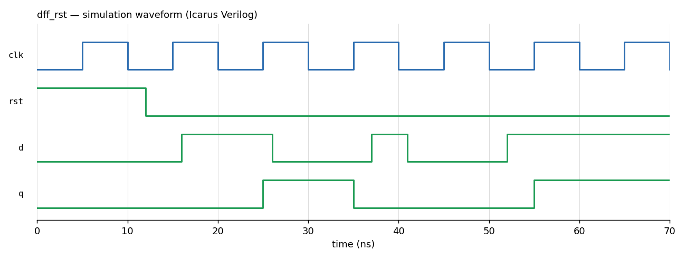
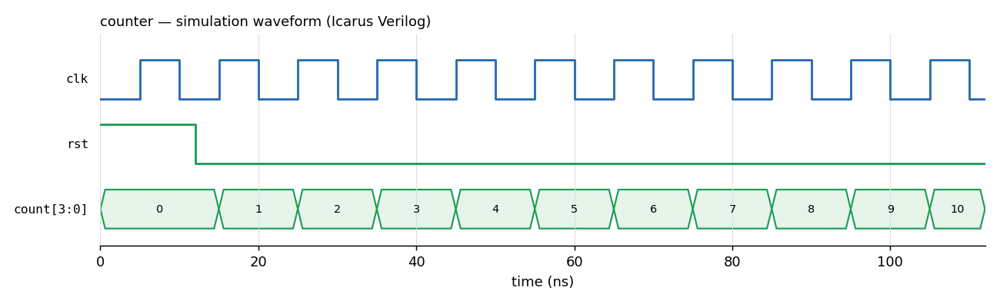
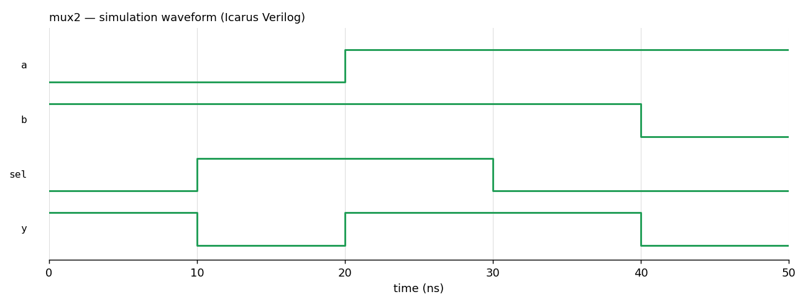
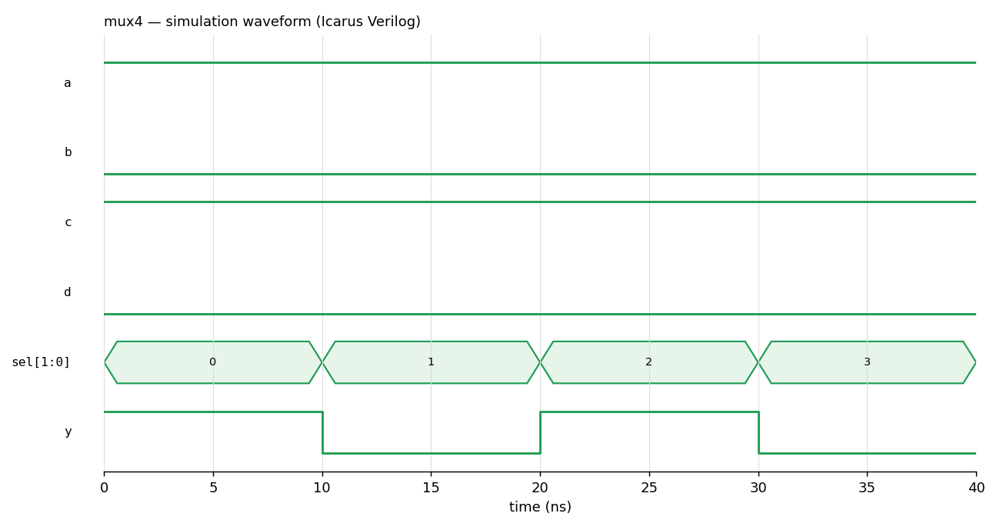
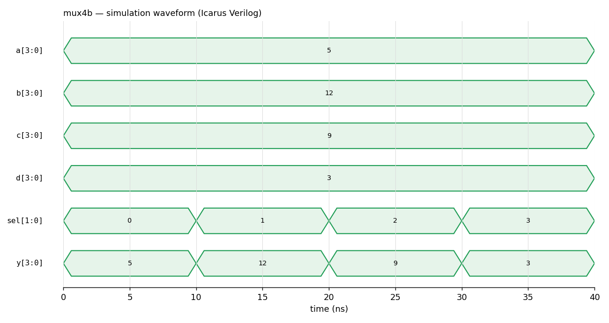
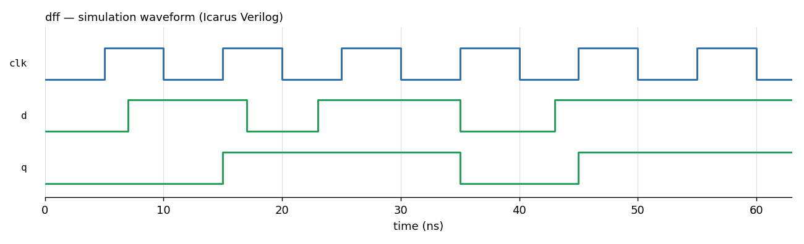

# Verilog Digital Design

Small RTL designs written while learning digital design with Verilog, each with its own testbench and a simulated waveform. Simulated with **Icarus Verilog** and inspected in **GTKWave** on Linux (WSL).

| Design | File | What it shows |
|---|---|---|
| 2-to-1 multiplexer | [`rtl/mux2.v`](rtl/mux2.v) | Combinational logic with `always @(*)` |
| 4-to-1 multiplexer | [`rtl/mux4.v`](rtl/mux4.v) | `case` statement on a 2-bit select |
| 4-to-1 multiplexer, 4-bit buses | [`rtl/mux4b.v`](rtl/mux4b.v) | Vector ports |
| D flip-flop | [`rtl/dff.v`](rtl/dff.v) | Edge-triggered storage, non-blocking assignment |
| D flip-flop with async reset | [`rtl/dff_rst.v`](rtl/dff_rst.v) | Asynchronous reset, capture delay, a pulse too short to be sampled |
| 4-bit counter | [`rtl/counter.v`](rtl/counter.v) | Sequential logic with reset |

## Waveforms

**D flip-flop with asynchronous reset** — `d` rises at 16 ns but `q` only follows at the next rising edge (25 ns). The short pulse between 37 and 41 ns falls between two edges, so `q` never sees it.



**4-bit counter** — held at 0 while `rst` is high, then counts up on every rising clock edge.



<details>
<summary>Multiplexers and plain D flip-flop</summary>






</details>

## Run it

```bash
sudo apt install iverilog gtkwave
bash run_all.sh                # compiles and simulates every design into build/
gtkwave build/dff_rst.vcd      # open a waveform
python tools/plot_vcd.py dff_rst   # optional: export a waveform as PNG
```

## Next

Finite state machines and moving the designs onto a real FPGA board.
