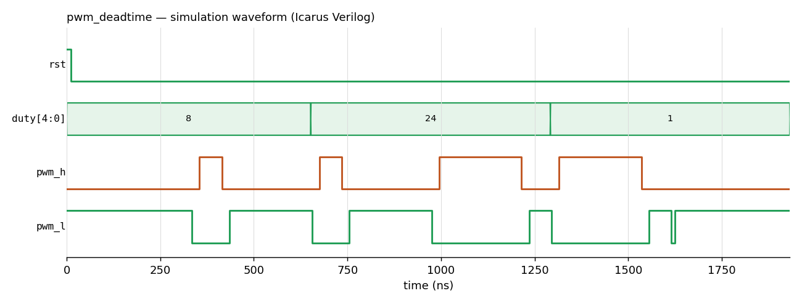

# Verilog Digital Design

RTL designs written while learning digital design with Verilog, from single building blocks up to a complementary PWM generator with dead-time for a half-bridge. Each design has its own testbench and a simulated waveform. Simulated with **Icarus Verilog** and inspected in **GTKWave** on Linux (WSL).

| Design | File | What it shows |
|---|---|---|
| 2-to-1 multiplexer | [`rtl/mux2.v`](rtl/mux2.v) | Combinational logic with `always @(*)` |
| 4-to-1 multiplexer | [`rtl/mux4.v`](rtl/mux4.v) | `case` statement on a 2-bit select |
| 4-to-1 multiplexer, 4-bit buses | [`rtl/mux4b.v`](rtl/mux4b.v) | Vector ports |
| D flip-flop | [`rtl/dff.v`](rtl/dff.v) | Edge-triggered storage, non-blocking assignment |
| D flip-flop with async reset | [`rtl/dff_rst.v`](rtl/dff_rst.v) | Asynchronous reset, capture delay, a pulse too short to be sampled |
| 4-bit counter | [`rtl/counter.v`](rtl/counter.v) | Sequential logic with reset |
| **Complementary PWM with dead-time** | [`rtl/pwm_deadtime.v`](rtl/pwm_deadtime.v) | Counter + register + comparator + FSM combined into one system |

## Complementary PWM generator with dead-time

A half-bridge (one leg of a motor drive or inverter) has a high-side and a low-side switch. If both conduct at the same time the supply is short-circuited (shoot-through). Real switches turn off slower than they turn on, so the controller must leave a short **dead-time** where both are off.

`pwm_deadtime` builds that controller from the blocks above:

| Block | Role |
|---|---|
| Counter | Sawtooth carrier; one PWM period = 2^WIDTH clocks |
| Register | Latches the new duty value only at the end of a period, so a change never cuts a pulse in half |
| Comparator | Raw PWM = carrier < duty |
| 4-state Moore FSM | `LOW → DEAD_UP → HIGH → DEAD_DN`; holds both outputs off for `DEADTIME` clocks at every transition, and skips pulses shorter than the dead-time |

The testbench uses a 5-bit carrier (32 clocks) and a 2-clock dead-time, steps the duty 25 % → 75 % → a 1-clock pulse, and checks on every clock that `pwm_h` and `pwm_l` are never high together. Result: `PASS: no shoot-through`; the measured gap is 20 ns (2 clocks) at every edge, and the 1-clock pulse is dropped instead of violating the dead-time.



## Building blocks — waveforms

**D flip-flop with asynchronous reset** — `d` rises at 16 ns but `q` only follows at the next rising edge (25 ns). The short pulse between 37 and 41 ns falls between two edges, so `q` never sees it.


**4-bit counter** — held at 0 while `rst` is high, then counts up on every rising clock edge.


<details>
<summary>Multiplexers and plain D flip-flop</summary>


</details>

## Run it

```bash
sudo apt install iverilog gtkwave
bash run_all.sh                # compiles and simulates every design into build/
gtkwave build/dff_rst.vcd      # open a waveform
python tools/plot_vcd.py dff_rst   # optional: export a waveform as PNG
```

## Next

Running `pwm_deadtime` on a real FPGA board and driving a half-bridge gate driver from it.
